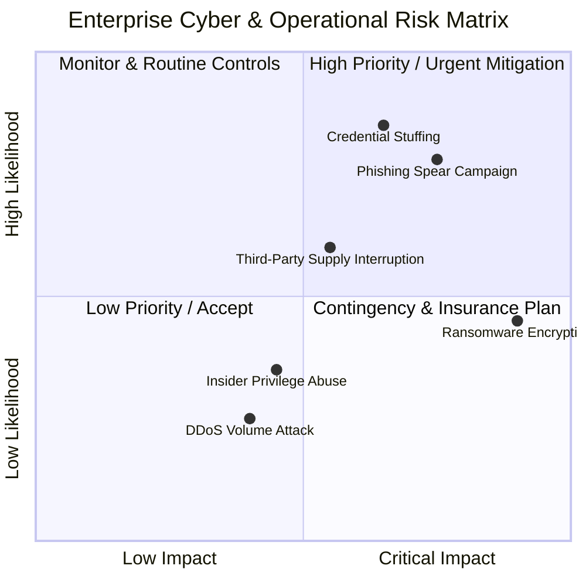

# 📜 ISO/IEC 27001:2022 GRC Audit Evidence, Risk Assessment & Exception Register

---

## 🎯 Executive Summary & Objective
Information security frameworks are meaningless without rigorous operational verification. Internal auditors and external certification bodies require non-repudiable proof that defined access control, logging, threat management, and exception procedures are strictly enforced.

In this project, I developed an **Enterprise GRC Audit & Risk Framework** mapped directly to **ISO/IEC 27001:2022 Annex A Controls**:
- Formulated an **Enterprise Risk Assessment Matrix** calculating Inherent vs Residual Risk across cyber and operational threats.
- Built an **Audit Evidence Register** providing traceable technical proof (PowerShell scripts, KQL export logs, Jira approvals) for key controls.
- Established an **Exception Tracking & Remediation Ledger** managing technical deviations with time-bound mitigation plans and executive sign-off.

---

## 📋 ISO/IEC 27001:2022 Control Mapping & Evidence Attestation

| ISO 27001:2022 Control | Control Title | Required Technical Evidence | Verification Source & Method | Audit Status |
|:---|:---|:---|:---|:---:|
| **Control A5.15** | Access Control | Written access policy, user role definitions | Azure Portal > Entra ID > RBAC roles | ✅ Compliant |
| **Control A5.16** | Identity Management | Formal JML onboarding / offboarding logs | Jira Service Desk ticket approval trails | ✅ Compliant |
| **Control A5.18** | Access Rights | Quarterly privilege attestation ledger | PowerShell AD inactive account extracts | ✅ Compliant |
| **Control A5.7** | Threat Intelligence | CTI register, threat actor profiling | AlienVault OTX & SOCRadar threat logs | ✅ Compliant |
| **Control A8.15** | Logging | Event log retention, NTP time sync validation | Sentinel Log Analytics Workspace rules | ✅ Compliant |
| **Control A8.16** | Monitoring Activities | Continuous SOC monitoring, threshold alerts | KQL alert rules, Sentinel incident queues | ✅ Compliant |
| **Control A8.20** | Network Security | Firewall access control lists, DMZ segregation | Azure Firewall & Network Security Groups | ✅ Compliant |

---

## 🎲 Enterprise Risk Scoring Matrix

Risk is quantified using the standard formula:
$$\text{Risk Score} = \text{Likelihood (1–5)} \times \text{Impact (1–5)}$$

---

## 📑 Technical Exception Register Template

When operational constraints prevent immediate compliance with a security control (e.g. legacy industrial software incompatible with MFA), an official **Security Exception Request** is logged:
1. **Exception ID**: `EXC-2026-0042`
2. **Impacted Control**: ISO 27001 Control A5.18 (Mandatory MFA)
3. **Business Justification**: Legacy warehouse handheld scanner firmware lacks modern FIDO2/TOTP browser authentication.
4. **Compensating Security Controls**:
   - Device isolated on an air-gapped VLAN with no internet breakout.
   - Access restricted strictly to internal warehouse ERP endpoints via IP-MAC binding.
   - 24/7 Sentinel anomaly rule monitoring traffic spikes.
5. **Expiration Date**: 90 Days (Mandatory re-certification).
6. **Executive Sign-Off**: Head of Information Security & VP of Operations.
