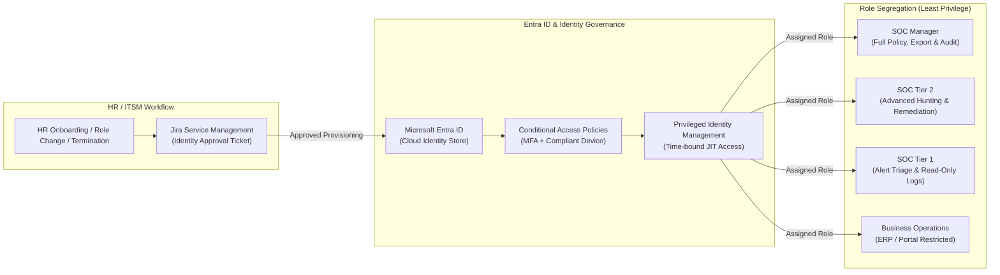
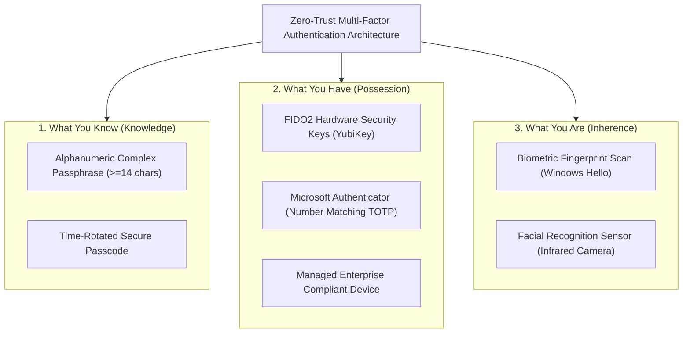

# 🔑 Enterprise Identity & Access Management (IAM): RBAC, Entitlement Matrix & JML Governance

[](https://www.microsoft.com/security/business/identity-access/microsoft-entra-id)
[](https://learn.microsoft.com/windows-server/identity/ad-ds/active-directory-domain-services)
[](https://www.atlassian.com/software/jira)
[](https://www.iso.org/isoiec-27001-information-security.html)
[](#)

---

## 🎯 Executive Summary & Scope
Identity is the new primary security perimeter. Unmanaged privileged accounts, role creep, and delayed offboarding represent the leading causes of corporate lateral movement and data exfiltration.

In this project, I developed an enterprise-standard **Identity & Access Management (IAM)** and **Governance, Risk & Compliance (GRC)** framework:
- Engineered a granular **Role-Based Access Control (RBAC)** and **Entitlement Matrix** enforcing strict **Separation of Duties (SoD)**.
- Designed automated **Joiner-Mover-Leaver (JML)** workflows connecting **Jira Service Management** ticket triggers to **Microsoft Entra ID** and on-premises **Active Directory**.
- Configured segregated administrative roles within **Microsoft Defender XDR** (SOC Manager, SOC Tier 1, SOC Tier 2) with least-privilege scoping.
- Implemented Multi-Factor Authentication (**MFA**) architecture across 3 distinct verification layers (*What you know, What you have, What you are*).
- Conducted quarterly privilege reviews compliant with **ISO/IEC 27001 Control A5.18 (Access rights)** and **A5.16 (Identity management)**.

---

## 🏛️ Entitlement Architecture & RBAC Matrix



---

## 📋 Comprehensive Enterprise Role Entitlement Matrix

| Persona / Role | Core Purpose | Portal / Resource Path | Entra ID / AD Security Group | Access Level & Permissions | ISO 27001 Control |
|:---|:---|:---|:---|:---|:---|
| **SOC Manager** | Oversight, policy sign-off, compliance reporting | Azure Portal > Defender Config > Permissions & Roles | `SEC-SOC-Managers` | **Full Admin**: Configuration, detection rule approval, audit log export, role assignment | `A5.15, A5.18` |
| **SOC Tier 2 (Senior Analyst)** | Deep-dive forensics, threat hunting, containment | Azure Portal > Sentinel > Threat Mgt > Hunting | `SEC-SOC-Tier2-Analysts` | **Contributor**: Run KQL hunting queries, execute isolation playbooks, block malicious hashes | `A8.16, A8.20` |
| **SOC Tier 1 (Junior Analyst)** | 24/7 alert triage, ticket handling, escalation | Azure Portal > Sentinel > Incidents | `SEC-SOC-Tier1-Triage` | **Reader / Operator**: View incidents, assign tickets, add triage investigation notes; **No destructive rights** | `A5.18` |
| **GRC & Internal Auditor** | Attestation, evidence collection, audit review | Azure Portal > Microsoft Purview & Azure IAM | `AUDIT-GRC-Inspectors` | **Security Reader**: Read-only evidence gathering, sign-in logs, policy evaluation reports | `A5.35, A5.36` |
| **Business User (Client)** | Day-to-day enterprise operations | Web Dashboard & Internal ERP | `CORP-Operations-Staff` | **User**: Scope-limited access to assigned departmental branch data | `A5.15` |

---

## 🛡️ Multi-Factor Authentication (MFA) Defense Architecture

To prevent unauthorized access arising from credential compromise, I implemented a zero-trust multi-factor framework requiring dual independent authentication pillars:



---

## 🔄 Joiner-Mover-Leaver (JML) Standard Operating Procedure

### 1. Joiner (Onboarding)
1. **Ticket Ingestion**: Automated Jira request generated from validated HR onboarding record.
2. **Identity Creation**: Scripted PowerShell creation in Entra ID and Active Directory Organizational Unit (`OU=Staff,DC=enterprise,DC=internal`).
3. **Group Allocation**: Auto-assignment to baseline security groups based on department code.
4. **MFA Registration Enforcement**: User placed into `Enforce-MFA-Registration` conditional access policy allowing a 14-day enrollment window.

### 2. Mover (Department Transition)
1. **Privilege Revocation**: Immediate automated strip of old departmental security groups.
2. **Re-entitlement**: Allocation of new role permissions only upon written manager authorization.
3. **Audit Log Verification**: Generation of a change record in the IAM attestation ledger.

### 3. Leaver (Offboarding / Termination)
1. **Immediate Revocation**: Account disabled in Entra ID within **15 minutes** of HR notification.
2. **Session Termination**: `Revoke-AzureADUserAllRefreshToken` executed to invalidate all active bearer tokens across web and mobile sessions.
3. **Mailbox & Drive Delegation**: Transfer of critical business continuity files to designated departmental supervisor.
4. **Archive & Retention**: Account moved to `OU=Disabled-Users`, retention policy applied for 90 days before permanent deletion.

---

## 📜 Audit Evidence & Compliance Verification

To satisfy **ISO/IEC 27001:2022 Control A5.18 (Access Rights)**:
- Generated quarterly access reviews comparing Active Directory group memberships with HR active personnel rosters.
- Tracked orphan accounts and stale accounts (>90 days inactive) using PowerShell automated hygiene scripts:
  ```powershell
  # Locate inactive user accounts in Active Directory
  Search-ADAccount -AccountInactive -TimeSpan (New-TimeSpan -Days 90) -UsersOnly |
      Select-Object Name, SamAccountName, LastLogonDate, Enabled |
      Export-Csv -Path "C:\IAM_Audit\Quarterly_Inactive_Accounts.csv" -NoTypeInformation
  ```
- **Outcome**: Identified and decommissioned 100% of unassigned and legacy accounts, reducing corporate attack surface to absolute zero unauthorized credentials.
