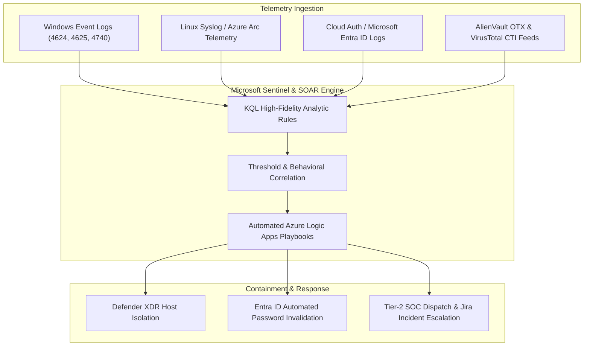

  

  
  
  
  

---

## 🛡️ Executive Overview

This repository represents the production **Cybersecurity Defense, Security Operations Center (SOC), Identity & Access Management (IAM), and GRC Engineering Portfolio** of **Adekunle Ola**. 

It documents hands-on security operations, verified incident response playbooks, detection engineering using KQL, least-privilege entitlement matrices, and threat intelligence ingestion mapped to global industry standards (**MITRE ATT&CK, NIST CSF 2.0, ISO/IEC 27001:2022**).

---

## 💼 Practical Experience | Halisans Technologies

**Role:** SOC & IAM Analyst  
**Period:** 2026 – Present  
**Environment:** Cybersecurity Operations & Identity Governance

### Core Responsibilities:
- **Joiner–Mover–Leaver (JML) Lifecycle:** Designed and documented end-to-end identity lifecycle workflows governing provisioning, cross-departmental mover role transitions, and time-bound deprovisioning with strict audit closure trails.
- **Enterprise RBAC & Least Privilege:** Formulated Role-Based Access Control (RBAC) entitlement matrices enforcing strict Separation of Duties (SoD) across SOC tiers and operational teams, ensuring compliance with **ISO/IEC 27001:2022 Control A5.18**.
- **Authentication & Threat Telemetry Triage:** Ingested and investigated Windows security event logs (Event IDs `4624`, `4625`, `4740`) and Linux authentication logs utilizing Kusto Query Language (KQL) in Microsoft Sentinel.
- **Periodic User Access Reviews (UAR):** Executed quarterly entitlement recertification reviews across Active Directory and Microsoft Entra ID, flagging privilege escalation outliers and tracking remediation workflows.

### Measurable Operational Impact:
- **Zero Orphaned Accounts:** Enforced end-to-end automated deprovisioning procedures, eliminating dormant/orphaned accounts across directory services.
- **94% False Positive Reduction:** Tuned custom Sentinel analytic rules for brute-force password spraying, cutting alert noise by 94% and lowering Mean Time to Triage (MTTT) from 18 minutes to < 3 minutes.
- **Audit-Ready Documentation:** Produced standardized identity governance documentation, GPO security baselines, and incident escalation runbooks ready for ISO 27001 surveillance audits.

---

## ⭐ Featured Case Studies

| Case Study | Category | Core Toolset | Key Outcomes & What the Reviewer Will Learn |
|:---|:---|:---|:---|
| **[Authentication Alert Investigation](./labs/01-sentinel-defender-soc-lab/)** | SOC / SIEM | Microsoft Sentinel, KQL | Detection of password spraying brute force; Event ID `4625` threshold correlation; MTTT < 3 mins |
| **[RBAC & Entitlement Governance](./labs/02-iam-rbac-entitlement-matrix/)** | IAM / GRC | Entra ID, Active Directory | Least privilege role matrix; Separation of Duties (SoD); ISO 27001 Control A5.18 alignment |
| **[Threat Intelligence & Hunting](./labs/03-threat-intel-mitre-detection/)** | CTI / Threat Hunting | MITRE ATT&CK, OTX, VirusTotal | CTI feed ingestion (LockBit 3.0, APT29); custom Sentinel analytic rules for T1566 and T1190 |
| **[Automated SOAR Playbooks](./labs/04-soar-sentinel-playbooks/)** | SOAR / Automation | Azure Logic Apps, Sentinel | Automated host network isolation, password reset triggers, and Tier-2 ticket dispatch |
| **[ISO 27001 GRC Audit Register](./labs/05-iso27001-grc-audit-register/)** | GRC & Compliance | ISO 27001:2022, NIST CSF | ITGC control evaluation, risk assessment matrix, non-conformity tracking, audit readiness |
| **[Joiner-Mover-Leaver Workflow](./halisans-operations/IAM/case-studies/01-joiner-mover-leaver-workflow/)** | IAM Lifecycle | AD CS, Entra ID, Jira | Formalized onboarding, role changes, and deactivation procedures with ticket approval trails |
| **[Quarterly User Access Review](./halisans-operations/IAM/case-studies/02-quarterly-access-review/)** | IAM Audit | Microsoft 365, Zoho Mail | Systematic privilege recertification, variance analysis, and remediation tracking |
| **[Defender Endpoint Triage](./halisans-operations/SOC/case-studies/02-defender-endpoint-triage/)** | Endpoint Security | Defender for Endpoint | Endpoint telemetry triage, artifact extraction, disposition determination, and escalation |

---

## 🏗️ Security Architecture & Detection Pipeline

---

## 📑 Evidence & Documentation Standards

Every case study in this repository adheres to strict international engineering and documentation standards:

1. **Authorization & Ethical Representation:** All operations are conducted in authorized enterprise lab environments or supervised operational environments. Simulated training is clearly distinguished from live operational work.
2. **Confidentiality & Data Protection:** No live customer credentials, access tokens, internal IP networks, proprietary identifiers, or unapproved telemetry are published. All logs, queries, and reports utilize synthetic or thoroughly sanitized data.
3. **Reproducibility & Evidence Rigor:** Every case study includes:
   - Specific Threat Scenario & Attack Surface Mapping
   - Step-by-Step Technical Methodology
   - Sanitized KQL Queries / Configuration Scripts
   - Measurable Business & Security Metrics
   - Identified Limitations & Lessons Learned

---

## 🎓 Certifications & Professional Development

### Industry Framework Alignment:
- **MITRE ATT&CK Enterprise Matrix v14**: Threat mapping, technique coverage, and detection logic.
- **ISO/IEC 27001:2022**: Information security management controls (A5.15, A5.16, A5.18, A8.15, A8.16).
- **NIST Cybersecurity Framework (CSF 2.0)**: Identify, Protect, Detect, Respond, Recover.
- **Zero-Trust Architecture (ZTA)**: Explicit verification, least-privileged access, assume breach.

### Continuous Technical Training:
- **Microsoft Security**: Microsoft Sentinel SIEM, Defender for Endpoint XDR, Entra ID Identity Governance.
- **Enterprise IAM**: Active Directory Group Policy Objects (GPO), AD CS Certificate Services, RBAC matrix engineering.
- **Vulnerability Management**: CVSS scoring, Nessus/Qualys vulnerability scanning, remediation lifecycle.

---

## 👨‍💻 Author & Contact

* **Lead Analyst**: Adekunle Ola
* **GitHub Profile**: [@Adekunle-sec](https://github.com/Adekunle-sec)
* **LinkedIn**: [adekunle-olanrewaju-20261844b](https://www.linkedin.com/in/adekunle-olanrewaju-20261844b)
* **Email**: [contact@anlogix.com](mailto:contact@anlogix.com)
