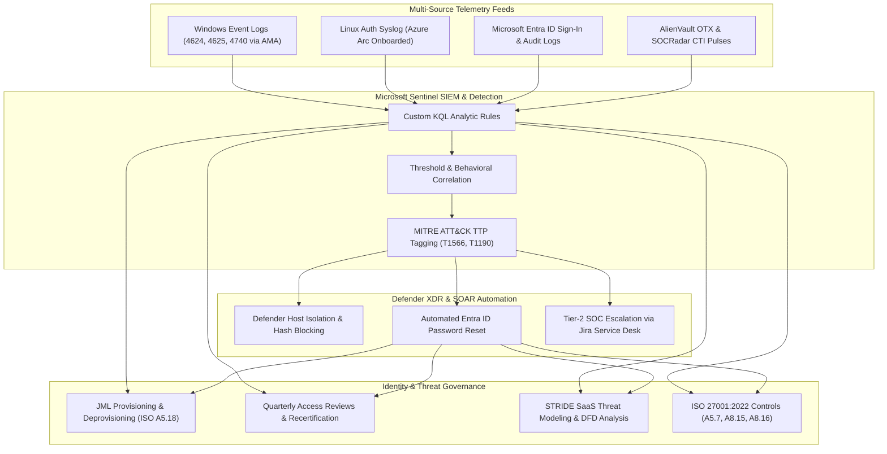

<p align="center">
  
</p>

<p align="center">
  <a href="https://github.com/Adekunle-sec"></a>
  <a href="https://www.linkedin.com/in/adekunle-olanrewaju-20261844b"></a>
  <a href="https://github.com/Adekunle-sec/data-analytics-portfolio"></a>
  <a href="mailto:tayour.ola@gmail.com"></a>
</p>

---

## 🛡️ Executive Overview

This repository is the unified enterprise **Cybersecurity Defense, Security Operations Center (SOC), Identity & Access Management (IAM), GRC Engineering, and Threat Modeling Monorepo** of **Adekunle Olanrewaju**.

It documents practical security operations, supervised assignments at **Halisans Technologies**, and production enterprise security engineering labs. It details **what was done, the methodologies applied, the sanitized evidence produced, and the measurable operational impact**.

All activities strictly adhere to global industry standards: **MITRE ATT&CK Enterprise Matrix v14, NIST CSF 2.0, and ISO/IEC 27001:2022**.

---

## 🧭 Monorepo Structure

```text
cybersecurity-portfolio/
├── .gitignore
├── README.md
├── cybersecurity-banner.svg
├── GRC/                                      # Governance, Risk & Compliance & Audit
│   ├── README.md
│   ├── case-studies/                         # Risk assessment, ISO 27001 & audit tracking
│   └── labs/                                 # ISO 27001 audit register lab
├── IAM/                                      # Identity & Access Management & Governance
│   ├── README.md
│   ├── case-studies/                         # JML lifecycle, RBAC matrix & access reviews
│   └── labs/                                 # RBAC entitlement matrix lab
└── SOC/                                      # Security Operations Center, SIEM/XDR & CTI
    ├── README.md
    ├── threat-modeling-risk-assessment-saas/ # STRIDE Threat Modeling & SaaS Risk Register
    │   ├── README.md
    │   ├── DFD.png                           # High-res OWASP Level-1 Data Flow Diagram
    │   ├── Threat_Risk_Register.xlsx         # 1,000-row STRIDE risk calculation register
    │   ├── Risk_Treatment_Plan.xlsx          # Remediation ownership and mitigation roadmap
    │   ├── Control_Mapping_Matrix.xlsx       # Cross-mapped to ISO 27001 & NIST SP 800-53
    │   ├── OWASP_Threat_Dragon_Report.pdf    # 24-page threat model executive report
    │   └── Threat_Modelling_Model.json       # Native Threat Dragon model file
    ├── threat-intelligence-and-detection/    # CTI pulses, IOC hunting & MITRE mapping
    ├── case-studies/                         # Alert triage, endpoint investigation & KQL
    └── labs/                                 # Hands-on Sentinel, Defender & SOAR labs
```

---

## 🛡️ Operational Pillars & Engineering Domains

### 1. 🛡️ Security Operations Center (SOC) & SIEM Analysis
**Primary Directory:** [`./SOC/`](./SOC/)  
**Role:** SOC Analyst | **Period:** 2026 – Present  
**Core Toolset:** Microsoft Sentinel, Microsoft Defender XDR, Splunk, Wazuh, Elastic, Gurucul (AI-driven UEBA), KQL, Azure Logic Apps, Azure Arc, Jira Service Management

#### Architectural Foundations:
- **Defense-in-Depth Architecture:**
  - *Microsoft Defender XDR:* Tactical guards on the ground inspecting local endpoints, identity logins, and email hygiene to halt threats instantly.
  - *Microsoft Sentinel SIEM/SOAR:* Central surveillance command center correlating Defender feeds, network firewalls, and cloud services for holistic observability.
- **The Core Triage Model:**
  - **Event:** Normal baseline operations on endpoints or networks.
  - **Alert:** Automated threshold trigger alerting analysts to an anomaly (*"Hey, look at this!"*).
  - **Incident:** Confirmed security event requiring analyst intervention, containment, and root cause analysis.
- **Multi-OS Telemetry Ingestion (Azure Arc & Azure Monitor Agent - AMA):**
  - Linux Onboarding: `chmod +x OnboardAzureArc.sh && sudo ./OnboardAzureArc.sh` (verification: `sudo azcmagent show`).
  - Windows Onboarding: `Set-ExecutionPolicy -ExecutionPolicy Bypass -Scope Process; .\OnboardAzureArc.ps1` (verification: `azcmagent show`).
  - Data Collection Rules (DCR) via XPath filtering:
    `security!*[System[(EventID=4624 OR EventID=4625 OR EventID=4740)]]`
- **Kerberos Authentication & Security Telemetry:**
  - Event ID `4624` (Successful Logon), Event ID `4625` (Failed Logon), Event ID `4740` (Account Lockout).
  - Kerberos Ticket-Granting System: Authentication Server (AS) verifying identity for Ticket Granting Ticket (TGT), Ticket Granting Server (TGS) issuing Service Tickets, and Client-Service mutual authentication.
  - Aligned to **ISO/IEC 27001 Controls A8.15 & A8.16 (Logging and Monitoring)**.

#### Featured SOC Case Studies & Labs:
| Case Study / Lab | Focus & Key Outcomes | Direct Link |
|:---|:---|:---|
| **Authentication Alert Investigation** | Investigate Windows 4624/4625/4740 telemetry with KQL and document investigative conclusions | [Explore Case Study →](./SOC/case-studies/01-authentication-alert-investigation/) |
| **Defender Endpoint Triage** | Review endpoint alerts, process execution trees, and hash-based containment | [Explore Case Study →](./SOC/case-studies/02-defender-endpoint-triage/) |
| **Sentinel Automation Playbook** | Azure Logic Apps incident triggers, ownership assignment, and automated notification | [Explore Case Study →](./SOC/case-studies/03-sentinel-automation-playbook/) |
| **SOC Monitoring Dashboard** | Sentinel workbooks for real-time authentication spikes and geolocational logins | [Explore Case Study →](./SOC/case-studies/04-soc-monitoring-dashboard/) |
| **Threat Intelligence & MITRE Hunting** | AlienVault OTX, SOCRadar, and VirusTotal IOC extraction into Sentinel rules | [Explore CTI Case Studies →](./SOC/threat-intelligence-and-detection/) |
| **Advanced Cloud SOC Lab** | High-fidelity password spraying detection rule reducing MTTT from 18 min to < 3 min | [Explore Lab →](./SOC/labs/01-sentinel-defender-soc-lab/) |
| **SOAR Sentinel Playbooks** | Automated host isolation and compromised credential remediation workflows | [Explore Lab →](./SOC/labs/04-soar-sentinel-playbooks/) |

---

### 2. 🔑 Identity & Access Management (IAM) & Identity Governance
**Primary Directory:** [`./IAM/`](./IAM/)  
**Role:** IAM Analyst | **Period:** 2026 – Present  
**Core Toolset:** Active Directory Domain Services, Microsoft Entra ID (Azure AD), AD CS, RBAC, PowerShell, Jira Service Management

#### Operational Highlights & Controls:
- **Multi-Factor Authentication (MFA) & Defense Layering:**
  - *What you know:* Complex passcodes, passphrases, challenge responses.
  - *What you are:* Biometric verification (fingerprint, Face ID, voice recognition).
  - *What you have:* Hardware FIDO2 keys and software authenticator tokens (TOTP).
- **Joiner–Mover–Leaver (JML) Governance:** Standardized provisioning workflows, department transfers, and time-bound deprovisioning with audit trails (zero orphaned accounts).
- **Enterprise RBAC & Separation of Duties (SoD):**
  - Configured role segregation within Microsoft Defender XDR (`Defender -> config -> permission -> roles`) distinguishing SOC Manager, SOC Tier-1, and SOC Tier-2 responsibilities.
  - Provisioned Sentinel Resource Group access permissions via Azure RBAC.
  - Configured Defender automated incident email alerts across user groups aligned to **ISO/IEC 27001:2022 Control A5.18 (Access Rights)**.
- **Access Recertification & GRC Audit Evidence:** Packaging user, group, and role evidence for compliance and quarterly access reviews (UAR).

#### Featured IAM Case Studies & Labs:
| Case Study / Lab | Focus & Key Outcomes | Direct Link |
|:---|:---|:---|
| **Joiner–Mover–Leaver Workflow** | Document authorized provisioning, changes, and deprovisioning with approval trails | [Explore Case Study →](./IAM/case-studies/01-joiner-mover-leaver-workflow/) |
| **Quarterly User Access Review** | Review entitlements, flag privilege exceptions, record owner decisions, and track fixes | [Explore Case Study →](./IAM/case-studies/02-quarterly-access-review/) |
| **RBAC & Least Privilege** | Implement an enterprise entitlement matrix and validate group/role assignments | [Explore Case Study →](./IAM/case-studies/03-rbac-and-least-privilege/) |
| **AD and Entra ID Administration** | Document identity configuration, GPOs, conditional access, and secure access controls | [Explore Case Study →](./IAM/case-studies/04-ad-and-entra-id-administration/) |
| **Enterprise RBAC Matrix Lab** | Production entitlement matrix enforcing SoD and least privilege across Tier 1–3 SOC | [Explore Lab →](./IAM/labs/02-iam-rbac-entitlement-matrix/) |

---

### 3. 📋 Governance, Risk & Compliance (GRC) & Audit Readiness
**Primary Directory:** [`./GRC/`](./GRC/)  
**Role:** GRC Analyst | **Period:** 2026 – Present  
**Core Toolset:** ISO/IEC 27001:2022, NIST CSF 2.0, NIST SP 800-53 Rev 5, Risk Registers, Control Matrices, Jira Service Management, Confluence

#### Governance Methodologies:
- **Enterprise Risk Register Modeling:** Continuous risk identification, threat-vulnerability mapping, likelihood/impact scoring, and residual risk computation.
- **ISO 27001:2022 Annex A Mapping:** Evaluating internal control effectiveness across:
  - *Control A5.7:* Threat Intelligence integration and feed validation.
  - *Control A5.18:* Access rights and segregation of duties.
  - *Controls A8.15 & A8.16:* Logging and security monitoring integrity.
- **Audit Evidence Indexing & Corrective Actions:** Structured ITGC workpapers, non-conformity tracking, and exception management workflows.

#### Featured GRC Case Studies & Labs:
| Case Study / Lab | Focus & Key Outcomes | Direct Link |
|:---|:---|:---|
| **Enterprise Risk Assessment** | Maintain a risk register with likelihood, impact, asset owners, treatment, and residual risk | [Explore Case Study →](./GRC/case-studies/01-enterprise-risk-assessment/) |
| **ISO 27001 Control Assessment** | Map control requirements to evidence, perform gap analysis, and document remediation | [Explore Case Study →](./GRC/case-studies/02-iso-27001-control-assessment/) |
| **Policy & Procedure Development** | Develop access control, acceptable use, and incident response governance procedures | [Explore Case Study →](./GRC/case-studies/03-policy-and-procedure-development/) |
| **Audit Evidence & Exception Tracking**| Build an evidence index, test ITGC control operation, and track exceptions to closure | [Explore Case Study →](./GRC/case-studies/04-audit-evidence-and-exception-tracking/) |
| **ISO 27001 Audit Register Lab** | Comprehensive ITGC control evaluation and non-conformity tracking dashboard | [Explore Lab →](./GRC/labs/05-iso27001-grc-audit-register/) |

---

### 4. 🚀 Student Login Portal | Threat Modeling & Risk Assessment
**Primary Directory:** [`./SOC/threat-modeling-risk-assessment-saas/`](./SOC/threat-modeling-risk-assessment-saas/)  
**Role:** Threat Modeling & Risk Specialist | **Status:** Production Security Audit (Halisans Technologies)  
**Core Toolset:** OWASP Threat Dragon, STRIDE Framework, CVSS v3.1, Risk Registers, ISO 27001:2022, NIST SP 800-53 Rev 5

#### Architecture & Deliverables:
- **System Scope:** Cloud-hosted Student Login Portal for Halisans Technologies enabling students to register, securely authenticate, and view academic profiles over HTTPS/TLS.
- **Three Core Processes:** Student Registration, Student Login, View Student Profile.
- **STRIDE Threat Decomposition:** Comprehensive analysis across Spoofing, Tampering, Repudiation, Information Disclosure, Denial of Service, and Elevation of Privilege.
- **Primary Deliverables:**
  - **Level-1 Data Flow Diagram (DFD):** [`DFD.png`](./SOC/threat-modeling-risk-assessment-saas/DFD.png) visual model illustrating trust boundaries and data flows.
  - **1,000-Row Threat Risk Register:** [`Threat_Risk_Register.xlsx`](./SOC/threat-modeling-risk-assessment-saas/Threat_Risk_Register.xlsx) with calculated CVSS v3.1 scores, likelihood, and business impact.
  - **Risk Treatment Plan:** [`Risk_Treatment_Plan.xlsx`](./SOC/threat-modeling-risk-assessment-saas/Risk_Treatment_Plan.xlsx) detailing designated owners, mitigations, and residual risk.
  - **Control Mapping Matrix:** [`Control_Mapping_Matrix.xlsx`](./SOC/threat-modeling-risk-assessment-saas/Control_Mapping_Matrix.xlsx) mapping threats directly to ISO 27001:2022 and NIST SP 800-53 Rev 5.
  - **24-Page Threat Model Report:** [`OWASP_Threat_Dragon_Report.pdf`](./SOC/threat-modeling-risk-assessment-saas/OWASP_Threat_Dragon_Report.pdf) and raw [`Threat_Modelling_Model.json`](./SOC/threat-modeling-risk-assessment-saas/Threat_Modelling_Model.json).
- 👉 **[Explore Full Threat Modeling Module →](./SOC/threat-modeling-risk-assessment-saas/)**

---

### 5. 🕵️ Threat Intelligence, Hunting & Detection Engineering
**Primary Directory:** [`./SOC/threat-intelligence-and-detection/`](./SOC/threat-intelligence-and-detection/)  
**Role:** Threat Intelligence & Detection Analyst | **Period:** 2026 – Present  
**Core Toolset:** AlienVault OTX, SOCRadar, MITRE ATT&CK, VirusTotal, Filigran (OpenCTI), abuse.ch, Microsoft Sentinel, KQL

#### Methodologies & Procedures:
- **IOA vs. IOC Differentiation:**
  - *IOA (Indicators of Attack):* Pre-attack behavioral patterns, process injection, unusual command-line invocations.
  - *IOC (Indicators of Compromise):* Post-attack forensic evidence (malicious IPs, SHA-256 hashes, C2 domains, DKIM/DMARC/SPF anomalies).
- **Threat Actor Profiling & TTP Mapping:**
  - Tracked threat actor groups: **APT29 (Cozy Bear), Lazarus Group, LockBit 3.0, Wizard Spider**.
  - Mapped observed behaviors against MITRE techniques: `T1190` (Exploit Public-Facing Application) and `T1566` (Phishing).
- **Phishing Simulation & Awareness (ISO 27001 Annex A6.3):**
  - Designed staff phishing simulations and awareness campaigns inspecting domains, subdomains, and email authentication (SPF, DKIM, DMARC) to build a human firewall against social engineering.
- **Risk-Based Vulnerability Management (ISO 27001 Annex A8.8):**
  - 4-stage vulnerability lifecycle: Asset Identification → Vulnerability Assessment → Exploitability-Based Prioritization (focusing on active in-the-wild exploitation rather than raw CVSS base severity) → Remediation & Verification Rescan.
- **Detection Engineering & Custom Hash Blocking:**
  - Querying global intelligence via Defender Intel Explorer.
  - Deploying custom block rules: `Defender -> Settings -> Endpoints -> Indicators -> File hashes -> Add indicator -> Action: Block execution`.
  - Ingesting CTI pulses from AlienVault OTX and SOCRadar into KQL detection rules.

---

## 🏗️ Technical Architecture & Telemetry Pipeline



---

## 📑 Evidence & Documentation Standards

> [!NOTE]
> **Confidentiality:** No real credentials, tokens, internal IPs, customer data, sensitive alerts, personal identifiers, or unapproved screenshots. Use synthetic or redacted evidence. Publish only materials approved for external sharing.

Every case study in this repository adheres to strict international engineering and documentation standards:
1. **Authorization & Ethical Representation:** All operations are conducted in authorized enterprise lab environments or supervised operational environments. Simulated training is clearly distinguished from live operational work.
2. **Confidentiality & Data Protection:** No live customer credentials, access tokens, internal IP networks, proprietary identifiers, or unapproved telemetry are published. All logs, queries, and reports utilize synthetic or thoroughly sanitized data.
3. **Reproducibility & Evidence Rigor:** Every case study includes:
   - Specific Threat Scenario & Attack Surface Mapping
   - Step-by-Step Technical Methodology
   - Sanitized KQL Queries / Configuration Scripts
   - Measurable Business & Security Metrics
   - Identified Limitations & Lessons Learned

---

## 🎓 Certifications & Professional Development

### Industry Framework Alignment:
- **MITRE ATT&CK Enterprise Matrix v14**: Threat mapping, technique coverage, and detection logic.
- **ISO/IEC 27001:2022**: Information security management controls (A5.7, A5.18, A8.15, A8.16).
- **NIST Cybersecurity Framework (CSF 2.0)**: Identify, Protect, Detect, Respond, Recover.
- **Zero-Trust Architecture (ZTA)**: Explicit verification, least-privileged access, assume breach.

### Continuous Technical Training:
- **Microsoft Security**: Microsoft Sentinel SIEM, Defender for Endpoint XDR, Entra ID Identity Governance.
- **Enterprise IAM**: Active Directory Group Policy Objects (GPO), AD CS Certificate Services, RBAC matrix engineering.
- **Vulnerability Management & GRC**: Risk Register modeling, ITGC control testing, Nessus scanning.

---

## 👨‍💻 Author & Contact

* **Lead Analyst**: Adekunle Olanrewaju
* **GitHub Profile**: [@Adekunle-sec](https://github.com/Adekunle-sec)
* **LinkedIn**: [adekunle-olanrewaju-20261844b](https://www.linkedin.com/in/adekunle-olanrewaju-20261844b)
* **Email**: [tayour.ola@gmail.com](mailto:tayour.ola@gmail.com)
