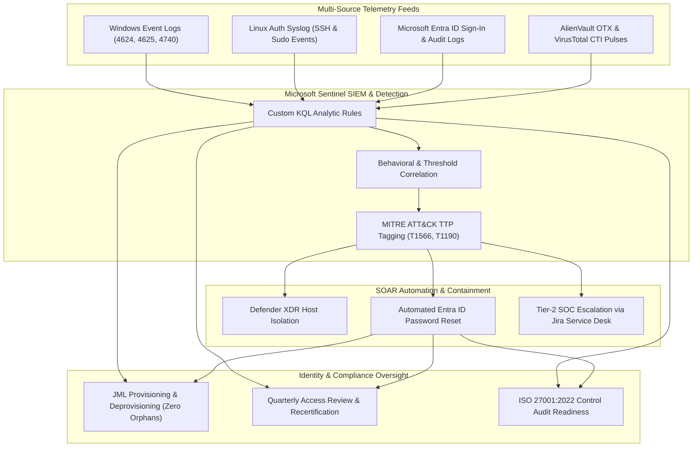

<p align="center">
  
</p>

<p align="center">
  <a href="https://github.com/Adekunle-sec"></a>
  <a href="https://www.linkedin.com/in/adekunle-olanrewaju-20261844b"></a>
  <a href="https://github.com/Adekunle-sec/data-analytics-portfolio"></a>
  <a href="mailto:contact@anlogix.com"></a>
</p>

---

## 🛡️ Executive Overview

This repository represents the production **Cybersecurity Defense, Security Operations Center (SOC), Identity & Access Management (IAM), and GRC Engineering Portfolio** of **Adekunle Olanrewaju**.

It documents practical security operations, supervised assignments at **Halisans Technologies**, and independent enterprise security labs. It covers **what was done, the methodologies applied, the sanitized evidence produced, and the measurable operational impact**.

All activities strictly adhere to global industry standards: **MITRE ATT&CK Enterprise Matrix v14, NIST CSF 2.0, and ISO/IEC 27001:2022**.

---

## 🧭 Four Core Operational Pillars | Halisans Technologies

```text
├── 🛡️ Pillar 1: Security Operations Center (SOC) & SIEM Analysis
├── 🔑 Pillar 2: Identity & Access Management (IAM) & Identity Governance
├── 📋 Pillar 3: Governance, Risk & Compliance (GRC) & Audit Readiness
└── 🕵️ Pillar 4: Threat Intelligence, Detection Engineering & MITRE ATT&CK
```

---

### 🛡️ Pillar 1: Security Operations Center (SOC) & SIEM

**Role:** SOC Analyst | **Period:** 2026 – Present  
**Core Toolset:** Microsoft Sentinel, Microsoft Defender XDR, KQL (Kusto Query Language), Azure Logic Apps, Windows Security Logs, Jira Service Management

#### Selected Responsibilities:
- **Authentication Alert Investigation:** Investigated Windows Event IDs `4624` (Successful Logon), `4625` (Failed Logon), and `4740` (Account Lockout) using custom KQL queries to identify brute force, password spraying, and anomalous authentication spikes.
- **Defender Endpoint Triage:** Triaged endpoint telemetry across Microsoft Defender for Endpoint, analyzed suspicious process execution trees, extracted process hashes, determined threat disposition, and initiated containment.
- **Sentinel Automation Playbook:** Built automated incident response playbooks in Azure Logic Apps triggered upon high-severity alert creation, automating initial ownership assignment, analyst Slack/Jira notifications, and host isolation.
- **SOC Monitoring Dashboard:** Developed interactive Sentinel workbooks providing real-time visibility into authentication telemetry, geographically anomalous logins, and MTTT metrics.

#### Featured SOC Case Studies:
| Case Study | Focus & What the Reviewer Will Learn | Direct Link |
|:---|:---|:---|
| **Authentication Alert Investigation** | Investigate Windows 4624/4625/4740 telemetry with KQL and document investigative conclusions | [Explore Case Study →](./halisans-operations/SOC/case-studies/01-authentication-alert-investigation/) |
| **Defender Endpoint Triage** | Review endpoint alerts, collect permitted evidence, determine disposition, and escalate | [Explore Case Study →](./halisans-operations/SOC/case-studies/02-defender-endpoint-triage/) |
| **Sentinel Automation Playbook** | Document incident-created triggers, ownership routing, automated testing, and safety checks | [Explore Case Study →](./halisans-operations/SOC/case-studies/03-sentinel-automation-playbook/) |
| **SOC Monitoring Dashboard** | Create workbook queries, visualize telemetry trends, explain metrics, and validate alerts | [Explore Case Study →](./halisans-operations/SOC/case-studies/04-soc-monitoring-dashboard/) |
| **Advanced Cloud SOC Lab** | High-fidelity password spraying detection rule reducing MTTT from 18 min to < 3 min | [Explore Lab →](./labs/01-sentinel-defender-soc-lab/) |

---

### 🔑 Pillar 2: Identity & Access Management (IAM)

**Role:** IAM Analyst | **Period:** 2026 – Present  
**Core Toolset:** Active Directory Domain Services, Microsoft Entra ID (Azure AD), AD CS, RBAC, PowerShell, Jira Service Management

#### Selected Responsibilities:
- **Joiner–Mover–Leaver (JML) Workflow:** Formulated and documented end-to-end identity lifecycle workflows governing provisioning, cross-departmental mover role transitions, and time-bound deprovisioning with auditable ticket closure evidence.
- **Enterprise RBAC & Least Privilege:** Designed an enterprise Role-Based Access Control (RBAC) entitlement matrix enforcing strict Separation of Duties (SoD) across operational groups (`HLS-SOC`, business units) in full compliance with **ISO/IEC 27001:2022 Control A5.18**.
- **Active Directory & Microsoft Entra ID Administration:** Implemented and tested directory configurations, Group Policy security baselines, and multi-factor authentication (MFA) requirements across hybrid identities.
- **Quarterly User Access Reviews (UAR):** Conducted entitlement recertification reviews across cloud and directory assets, flagging access creep, isolating unauthorized permissions, and documenting remediation outcomes.

#### Featured IAM Case Studies:
| Case Study | Focus & What the Reviewer Will Learn | Direct Link |
|:---|:---|:---|
| **Joiner–Mover–Leaver Workflow** | Document authorized provisioning, changes, and deprovisioning with approval trails | [Explore Case Study →](./halisans-operations/IAM/case-studies/01-joiner-mover-leaver-workflow/) |
| **Quarterly User Access Review** | Review entitlements, flag privilege exceptions, record owner decisions, and track fixes | [Explore Case Study →](./halisans-operations/IAM/case-studies/02-quarterly-access-review/) |
| **RBAC & Least Privilege** | Implement an enterprise entitlement matrix and validate group/role assignments | [Explore Case Study →](./halisans-operations/IAM/case-studies/03-rbac-and-least-privilege/) |
| **AD and Entra ID Administration** | Document identity configuration, GPOs, conditional access, and secure access controls | [Explore Case Study →](./halisans-operations/IAM/case-studies/04-ad-and-entra-id-administration/) |
| **Enterprise RBAC Matrix Lab** | Production entitlement matrix enforcing SoD and least privilege across Tier 1–3 SOC | [Explore Lab →](./labs/02-iam-rbac-entitlement-matrix/) |

---

### 📋 Pillar 3: Governance, Risk & Compliance (GRC)

**Role:** GRC Analyst | **Period:** 2026 – Present  
**Core Toolset:** ISO/IEC 27001:2022, NIST CSF 2.0, Risk Registers, Control Matrices, Jira Service Management, Excel

#### Selected Responsibilities:
- **Enterprise Risk Assessment:** Maintained an operational risk register evaluating threats, vulnerabilities, likelihood, and business impact to compute inherent and residual risk scores.
- **ISO 27001 Control Assessment:** Mapped organizational control implementations to **ISO/IEC 27001:2022 Annex A** controls, identified gaps, and documented corrective action plans.
- **Policy & Procedure Development:** Authored and reviewed organizational security policies including Access Control, Acceptable Use, and Incident Response Procedures.
- **Audit Evidence & Exception Tracking:** Built an auditable evidence index, tested control operational effectiveness, and tracked audit exceptions to closure.

#### Featured GRC Case Studies:
| Case Study | Focus & What the Reviewer Will Learn | Direct Link |
|:---|:---|:---|
| **Enterprise Risk Assessment** | Maintain a risk register with likelihood, impact, asset owners, treatment, and residual risk | [Explore Case Study →](./halisans-operations/GRC/case-studies/01-enterprise-risk-assessment/) |
| **ISO 27001 Control Assessment** | Map control requirements to evidence, perform gap analysis, and document remediation | [Explore Case Study →](./halisans-operations/GRC/case-studies/02-iso-27001-control-assessment/) |
| **Policy & Procedure Development** | Develop access control, acceptable use, and incident response governance procedures | [Explore Case Study →](./halisans-operations/GRC/case-studies/03-policy-and-procedure-development/) |
| **Audit Evidence & Exception Tracking**| Build an evidence index, test ITGC control operation, and track exceptions to closure | [Explore Case Study →](./halisans-operations/GRC/case-studies/04-audit-evidence-and-exception-tracking/) |
| **ISO 27001 Audit Register Lab** | Comprehensive ITGC control evaluation and non-conformity tracking dashboard | [Explore Lab →](./labs/05-iso27001-grc-audit-register/) |

---

### 🕵️ Pillar 4: Threat Intelligence & Security Analysis

**Role:** Threat Intelligence & Detection Analyst | **Period:** 2026 – Present  
**Core Toolset:** AlienVault OTX, SOCRadar, MITRE ATT&CK, VirusTotal, Microsoft Sentinel, KQL

#### Selected Responsibilities:
- **Threat Intelligence Assessment:** Extracted and evaluated tactical intelligence pulses from AlienVault OTX and SOCRadar, validating indicator fidelity and assessing local infrastructure relevance.
- **IOC-to-Detection Handoff:** Translated validated threat actor hypotheses (e.g., APT29, LockBit 3.0) into operational KQL detection rules for deployment to the SOC SIEM.
- **MITRE ATT&CK Mapping:** Deconstructed adversary tactics, techniques, and procedures (TTPs) across the MITRE ATT&CK Enterprise Matrix, separating verified telemetry from assumptions.
- **Security Investigation Reporting:** Correlated multi-source telemetry, evaluated adversary dwell time and scope, and produced executive incident reports with remediation guidance.

#### Featured Threat Intelligence Case Studies:
| Case Study | Focus & What the Reviewer Will Learn | Direct Link |
|:---|:---|:---|
| **Threat Intelligence Assessment** | Ingest OTX/SOCRadar threat feeds, validate indicators, and evaluate local relevance | [Explore Case Study →](./halisans-operations/Security-Analysis/case-studies/01-threat-intelligence-assessment/) |
| **IOC-to-Detection Handoff** | Translate a threat hypothesis into an operational KQL detection rule and SOC handoff | [Explore Case Study →](./halisans-operations/Security-Analysis/case-studies/02-ioc-to-detection-handoff/) |
| **MITRE ATT&CK Mapping** | Map observed adversary behaviors to techniques, distinguishing evidence from assumptions | [Explore Case Study →](./halisans-operations/Security-Analysis/case-studies/03-mitre-attandck-mapping/) |
| **Security Investigation Report** | Correlate telemetry, assess organizational impact, and formulate remediation actions | [Explore Case Study →](./halisans-operations/Security-Analysis/case-studies/04-security-investigation-report/) |
| **Threat Hunting & Detection Lab** | Behavioral detection rules targeting LockBit 3.0 and APT29 macro execution | [Explore Lab →](./labs/03-threat-intel-mitre-detection/) |

---

## 🏗️ Technical Architecture & Telemetry Pipeline



---

## 📑 Evidence & Documentation Standards

Every case study in this repository adheres to strict international engineering and documentation standards:

1. **Authorization & Ethical Representation:** All operations are conducted in authorized enterprise lab environments or supervised operational environments. Simulated training is clearly distinguished from live operational work.
2. **Confidentiality & Data Protection:** No live customer credentials, access tokens, internal IP networks, proprietary identifiers, or unapproved telemetry are published. All logs, queries, and reports utilize synthetic or thoroughly sanitized data.
3. **Reproducibility & Evidence Rigor:** Every case study includes:
   - Specific Threat Scenario & Attack Surface Mapping
   - Step-by-Step Technical Methodology
   - Sanitized KQL Queries / Configuration Scripts
   - Measurable Business & Security Metrics
   - Identified Limitations & Lessons Learned

---

## 🎓 Certifications & Professional Development

### Industry Framework Alignment:
- **MITRE ATT&CK Enterprise Matrix v14**: Threat mapping, technique coverage, and detection logic.
- **ISO/IEC 27001:2022**: Information security management controls (A5.15, A5.16, A5.18, A8.15, A8.16).
- **NIST Cybersecurity Framework (CSF 2.0)**: Identify, Protect, Detect, Respond, Recover.
- **Zero-Trust Architecture (ZTA)**: Explicit verification, least-privileged access, assume breach.

### Continuous Technical Training:
- **Microsoft Security**: Microsoft Sentinel SIEM, Defender for Endpoint XDR, Entra ID Identity Governance.
- **Enterprise IAM**: Active Directory Group Policy Objects (GPO), AD CS Certificate Services, RBAC matrix engineering.
- **Vulnerability Management & GRC**: Risk Register modeling, ITGC control testing, Nessus scanning.

---

## 👨‍💻 Author & Contact

* **Lead Analyst**: Adekunle Olanrewaju
* **GitHub Profile**: [@Adekunle-sec](https://github.com/Adekunle-sec)
* **LinkedIn**: [adekunle-olanrewaju-20261844b](https://www.linkedin.com/in/adekunle-olanrewaju-20261844b)
* **Email**: [contact@anlogix.com](mailto:contact@anlogix.com)
