# 🕵️ Cyber Threat Intelligence (CTI), IOC Hunting & MITRE ATT&CK Detection Engineering

[](https://attack.mitre.org/)
[](https://www.virustotal.com/)
[](https://otx.alienvault.com/)
[](https://socradar.io/)
[](https://azure.microsoft.com/services/azure-sentinel/)

---

## 🎯 Executive Summary & Objective
Reactive security operations fail because adversaries continuously evolve their infrastructure and techniques. Modern defensive engineering requires **proactive Threat Intelligence (CTI)**: identifying adversary tactics, techniques, and procedures (TTPs), isolating indicators of compromise (IOCs), and converting raw intelligence into operational detection rules before an intrusion succeeds.

In this project, I established an end-to-end **Threat Intelligence & Detection Engineering pipeline**:
- Ingested real-world threat feeds using **AlienVault OTX (Open Threat Exchange)**, **SOCRadar**, and **VirusTotal**.
- Profiled prominent Advanced Persistent Threat (APT) groups including **APT29 (Cozy Bear)**, **Lazarus Group**, and ransomware operators (**LockBit 3.0**, **Wizard Spider**).
- Mapped adversary behaviors against the **MITRE ATT&CK Enterprise Matrix** (focusing on `T1566 Phishing`, `T1190 Exploit Public-Facing Application`, and `T1059 Command & Scripting Interpreter`).
- Extracted, normalized, and validated IOCs (SHA-256 file hashes, malicious C2 IP addresses, phishing domains, spoofed DKIM/SPF headers).
- Authored production-ready **KQL custom detection rules** and Microsoft Defender XDR Indicators of Compromise.

---

## 🔄 Threat Intelligence Lifecycle Pipeline

```mermaid
flowchart LR
    subgraph Collection["1. Intelligence Collection"]
        OTX["AlienVault OTX\n(Adversary Pulses)"]
        SR["SOCRadar\n(Actor Feeds & CTI)"]
        VT["VirusTotal Intelligence\n(Multiscanner Validation)"]
    end

    subgraph Processing["2. Analysis & Attribution"]
        MITRE["MITRE ATT&CK Mapping\n(Tactics & Techniques)"]
        ACTOR["Threat Actor Profiling\n(APT29, Lazarus, LockBit)"]
        IOC_IOA["IOC vs IOA Triage\n(Hashes, IPs, Domains, Headers)"]
    end

    subgraph Operationalization["3. Detection Engineering"]
        KQL["Sentinel Analytics Rule\n(KQL Scheduled Alert)"]
        DEF_IND["Defender for Endpoint\n(Automated Block Indicator)"]
        SOAR_PB["SOC Handover Record\n& Threat Register"]
    end

    Collection --> Processing
    Processing --> Operationalization
```



---

## 🎯 Threat Actor Profiling & MITRE ATT&CK Mapping Matrix

| Threat Actor | Origin / Motivation | Target Sectors | MITRE Tactic | Technique ID & Name | Observed IOC / Behavioral Pattern |
|:---|:---|:---|:---|:---|:---|
| **APT29** *(Cozy Bear)* | State-sponsored / Espionage | Government, Think Tanks, Telecoms | Initial Access | [T1566.002](https://attack.mitre.org/techniques/T1566/002/) Spearphishing Link | Trusted cloud hosting domains (`onedrive-share[.]live`) distributing weaponized LNK files |
| **Lazarus Group** | State-sponsored / Financial & Espionage | Financial Services, Crypto, Defense | Execution | [T1059.001](https://attack.mitre.org/techniques/T1059/001/) PowerShell Injection | Base64-encoded command line payloads spawning disguised `rundll32.exe` processes |
| **LockBit 3.0** | Cybercrime Syndicate / Ransomware | Manufacturing, Retail, Healthcare | Impact & Defense Evasion | [T1486](https://attack.mitre.org/techniques/T1486/) Data Encrypted for Impact | VSSAdmin shadow copy deletion (`vssadmin delete shadows /all /quiet`) |
| **Wizard Spider** | Cybercrime / Financial Intrusion | Enterprise Supply Chain, Logistics | Credential Access | [T1003.001](https://attack.mitre.org/techniques/T1003/001/) LSASS Memory Dumping | `procdump64.exe -ma lsass.exe` targeting domain admin credentials in memory |

---

## 🛠️ Detection Engineering: Translating Intel into Sentinel KQL

### 🔍 Production Detection Rule 1: High-Confidence Threat Intel IP Match
Correlates all incoming and outbound firewall, proxy, and DNS traffic against the enterprise Threat Intelligence indicator repository.

```kql
let dt_lookback = 1d;
let ThreatIntelIPs = ThreatIntelligenceIndicator
| where TimeGenerated >= ago(dt_lookback)
| where IsActive == true
| where isnotempty(NetworkIP) or isnotempty(EmailSenderIP)
| extend ThreatIP = coalesce(NetworkIP, EmailSenderIP)
| project ThreatIP, Description, ConfidenceScore, ThreatType, IndicatorId;
// Correlate with Azure Firewall / Network traffic
CommonSecurityLog
| where TimeGenerated >= ago(1h)
| extend DestinationIP = DestinationIP
| join kind=inner (ThreatIntelIPs) on $left.DestinationIP == $right.ThreatIP
| project TimeGenerated, DeviceVendor, Activity, SourceIP, DestinationIP, ThreatType, ConfidenceScore, Description
| order by ConfidenceScore desc
```

### 🔍 Production Detection Rule 2: Phishing Execution via Suspicious Parent-Child Process
Detects Microsoft Office processes (such as Word or spreadsheet applications) invoking shell interpreters (`powershell.exe`, `cmd.exe`, `wscript.exe`), a primary hallmark of weaponized email attachments ([T1566.001](https://attack.mitre.org/techniques/T1566/001/)).

```kql
DeviceProcessEvents
| where TimeGenerated >= ago(1d)
| where InitiatingProcessFileName in~ ("winword.exe", "excel.exe", "powerpnt.exe", "outlook.exe")
| where FileName in~ ("cmd.exe", "powershell.exe", "pwsh.exe", "cscript.exe", "wscript.exe", "mshta.exe")
| project TimeGenerated, DeviceName, User = AccountName, ParentProcess = InitiatingProcessFileName, SpawningProcess = FileName, ProcessCommandLine = ProcessCommandLine
| order by TimeGenerated desc
```

---

## 🔒 Defender for Endpoint: Automated Custom Block Indicators

To enforce instantaneous perimeter blocks across enterprise endpoints:
1. Navigated to **Microsoft Defender XDR > Settings > Endpoints > Indicators**.
2. Uploaded validated high-risk SHA-256 hashes extracted from threat intelligence pulses.
3. Configured action parameter: **Block and Remediate**.
4. Set scope: **All Device Groups**.
5. Alert title: `[Threat Intel Block] Known LockBit 3.0 Cryptor Variant Identified`.

---

## 📊 Deliverables & Operational Handover
- **Enterprise Threat Register**: Maintained a structured ledger recording Threat Actor name, MITRE Technique ID, Associated IOCs, Date Ingested, Validation Source, and Associated Detection Rule ID.
- **SOC Shift Handover Report**: Established weekly threat briefing documentation detailing newly emerging CVEs (e.g. CVSS 9.8 Remote Code Execution vulnerabilities) with proactive hunt queries.
