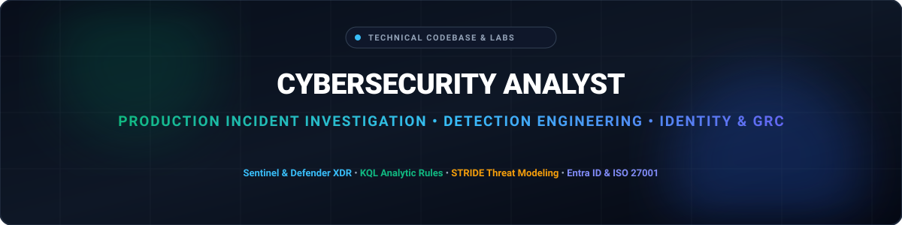

  

  
  
  
  

---

# Adekunle Olanrewaju | Cybersecurity Analyst

### Cyber Threat Intelligence | Security Investigation | MITRE ATT&CK | Detection Engineering

📍 Lagos, Nigeria · [LinkedIn](https://www.linkedin.com/in/adekunle-olanrewaju-20261844b) · [tayour.ola@gmail.com](mailto:tayour.ola@gmail.com) · [GitHub Profile](https://github.com/Adekunle-sec)

---

## 🎯 Professional Profile

I am a **Cybersecurity Analyst specializing in Threat Intelligence, Detection Engineering, and Security Analysis** with hands-on experience at **Halisans Technologies**. My portfolio documents verified security operations: analyzing pre-attack Indicators of Attack (IOAs) vs. Indicators of Compromise (IOCs), ingesting threat pulses from AlienVault OTX and SOCRadar, validating indicator fidelity via VirusTotal, engineering custom KQL detection rules, and mapping adversary behaviors directly to the **MITRE ATT&CK Enterprise Matrix v14**.

---

## 💼 Practical Experience | Halisans Technologies

**Role:** Threat Intelligence & Detection Analyst  
**Period:** 2026 – Present  
**Environment:** Supervised Cybersecurity Operations, SOC Defense & CTI Analysis

### Selected Responsibilities & Operational Activities:
- **Threat Intelligence Ingestion & Assessment:** Evaluated tactical intelligence pulses across AlienVault OTX (Pulses, Groups, Users) and SOCRadar, validating indicator fidelity, analyzing digital certificate signatures, and determining local relevance.
- **IOC-to-Detection Engineering:** Translated validated threat actor hypotheses (e.g., LockBit 3.0, APT29) into operational KQL analytic rules deployed in Microsoft Sentinel and Defender Advanced Hunting.
- **MITRE ATT&CK Matrix Mapping:** Deconstructed adversary tactics, techniques, and procedures (TTPs), separating forensic telemetry from assumptions, focusing on techniques such as `T1190` (Exploit Public-Facing Application) and `T1566` (Phishing).
- **Incident Investigation & Reporting:** Correlated multi-source endpoint and authentication telemetry, evaluated dwell times, and formulated actionable containment recommendations in formal SOC handover reports.

### Impact Highlights:
- Established high-fidelity threat hunting pipelines integrating AlienVault OTX pulses and VirusTotal multiscanner scoring to pre-emptively identify emerging campaigns.
- Developed automated KQL detection queries in Microsoft Sentinel to intercept weaponized phishing payloads and macro executions.
- Standardized CTI-to-SOC handover documentation, accelerating Tier-1 alert triage and reducing mean time to detect (MTTD).

---

## 📂 Featured Case Studies

| Case Study | Focus & What the Reviewer Will Learn | Reference Link |
|---|---|---|
| **[01. Threat Intelligence Assessment](./case-studies/01-threat-intelligence-assessment/README.md)** | Ingest and evaluate OTX/SOCRadar threat pulses, validate indicators, and assess organizational relevance. | [View Case Study →](./case-studies/01-threat-intelligence-assessment/README.md) |
| **[02. IOC-to-Detection Handoff](./case-studies/02-ioc-to-detection-handoff/README.md)** | Translate validated threat hypotheses into operational KQL detection rules and formal SOC handover records. | [View Case Study →](./case-studies/02-ioc-to-detection-handoff/README.md) |
| **[03. MITRE ATT&CK Mapping](./case-studies/03-mitre-attandck-mapping/README.md)** | Map observed adversary behaviors and forensic telemetry to MITRE techniques, separating evidence from assumptions. | [View Case Study →](./case-studies/03-mitre-attandck-mapping/README.md) |
| **[04. Security Investigation Report](./case-studies/04-security-investigation-report/README.md)** | Correlate multi-source telemetry, assess organizational impact, and formulate post-incident remediation strategies. | [View Case Study →](./case-studies/04-security-investigation-report/README.md) |

---

## 🛠️ Technical Capabilities & Tooling

- **Threat Intelligence Feeds:** AlienVault OTX, SOCRadar, VirusTotal, Filigran (OpenCTI), abuse.ch
- **Frameworks & Standards:** MITRE ATT&CK Enterprise Matrix v14, ISO/IEC 27001:2022 Control A5.7, NIST SP 800-61 Rev 2
- **SIEM & Detection Platforms:** Microsoft Sentinel, Microsoft Defender XDR, Log Analytics Workspaces
- **Query & Hunting Languages:** KQL (Kusto Query Language), PowerShell, Regex
- **Collaboration & Ticketing:** Jira Service Management, Confluence, GitHub

---

## 🛡️ Evidence & Documentation Standards

Every featured case study adheres to rigorous enterprise documentation standards:
- **Ethical & Authorized Scope:** All investigations are conducted within authorized corporate lab environments or approved operational scopes.
- **Sanitized Telemetry:** No real credentials, proprietary tokens, internal IPs, customer data, or confidential identifiers are published. All forensic data uses synthetic or sanitized artifacts.
- **Reproducibility:** Query logic, IOC tables, and ATT&CK mappings are documented to support verification and peer review.

---

## 📬 Contact & Links

- **LinkedIn:** [linkedin.com/in/adekunle-olanrewaju-20261844b](https://www.linkedin.com/in/adekunle-olanrewaju-20261844b)
- **Email:** [tayour.ola@gmail.com](mailto:tayour.ola@gmail.com)
- **GitHub:** [github.com/Adekunle-sec](https://github.com/Adekunle-sec)
- **Monorepo:** [Adekunle-sec / cybersecurity-portfolio](https://github.com/Adekunle-sec/cybersecurity-portfolio)

---
*All operational case studies are verified, sanitized, and evidence-backed.*
