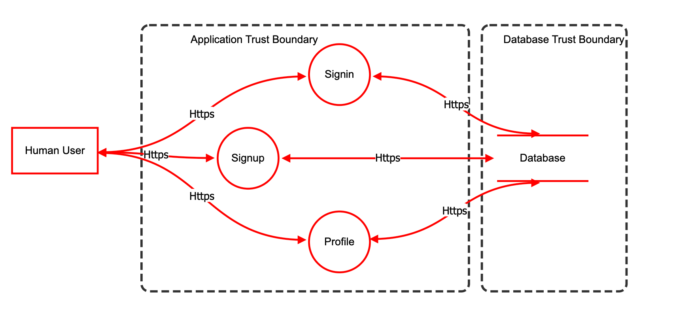
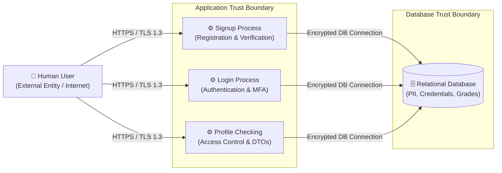

# 🛡️ Threat Modeling & Risk Assessment for a SaaS Product

### Production STRIDE Threat Model, Data Flow Diagram (DFD) & Comprehensive Risk Treatment Suite

<p align="center">
  
</p>

<p align="center">
  <a href="https://github.com/Adekunle-sec"></a>
  <a href="https://github.com/Adekunle-sec/cybersecurity-portfolio"></a>
  <a href="https://www.linkedin.com/in/adekunle-olanrewaju-20261844b"></a>
  <a href="mailto:tayour.ola@gmail.com"></a>
</p>

---

## 📌 Repository Overview & Purpose

This repository contains the comprehensive **STRIDE Threat Modeling, Architectural Risk Assessment, and Security Control Engineering Suite** for a cloud-hosted Software-as-a-Service (SaaS) web application (**Student & Academic Self-Service Web Portal**).

Developed using **OWASP Threat Dragon v2.6.2**, this engagement deconstructs the application architecture, identifies multi-tier threat vectors across trust boundaries, calculates quantitative risk metrics (CVSS 3.1, Inherent vs. Residual Risk scores), formulates actionable treatment plans with designated asset owners, and maps security controls directly to **ISO/IEC 27001:2022 Annex A** and **NIST SP 800-53 Rev 5**.

> **Description:** The Repo contains the DFD and RISK register of a SaaS product.

---

## 🏗️ System Architecture & Data Flow Diagram (DFD)

The target SaaS platform enables enrolled students to securely authenticate, register for institutional services, update sensitive personal contact records, and access academic grades over public networks.

### 🖼️ Level-1 Data Flow Diagram (DFD)
<p align="center">
  
</p>

### 📐 Architectural Trust Boundaries & Elements



1. **External Entity (`Human User`):** Unauthenticated and authenticated users operating outside the institutional trust perimeter on untrusted public networks.
2. **Application Processing Tier (`Application Trust Boundary`):**
   - **Signup Process:** Validates institutional eligibility, verifies university email ownership, enforces password strength, and provisions new accounts.
   - **Login Process:** Authenticates returning students via credentials and Multi-Factor Authentication (MFA), enforces sliding-window rate limiting, and issues cryptographically signed session tokens.
   - **Profile Checking Process:** Enforces strict session token binding and object-level authorization to allow students to view and update permitted contact details.
3. **Data Persistence Tier (`Database Trust Boundary`):**
   - **Relational Database:** Isolated backend data tier storing salted password hashes (Argon2id), MFA secrets, student Personally Identifiable Information (PII), and academic transcripts.
4. **Data Flows (`HTTPS / TLS 1.3`):** Bidirectional, encrypted communication channels protected by Transport Layer Security (TLS 1.3) with HTTP Strict Transport Security (HSTS).

---

## 🎯 STRIDE Threat Taxonomy & Attack Scenarios

The architecture was evaluated against the **STRIDE** methodology (Spoofing, Tampering, Repudiation, Information Disclosure, Denial of Service, Elevation of Privilege):

| STRIDE Category | Risk ID | Threat Scenario | Primary Attack Vector | Inherent Severity |
|:---|:---|:---|:---|:---:|
| **Spoofing** | `NST01` | Student Account Takeover & Identity Spoofing | Automated credential stuffing, password spraying, or session token hijacking over unmanaged networks. | **Critical** (14.04) |
| **Tampering** | `NST06` | Unauthorized Record Alteration & Parameter Manipulation | HTTP request payload manipulation (mass assignment) or SQL/NoSQL injection crossing the database boundary to falsify grades or enrollment status. | **Critical** (14.04) |
| **Repudiation** | `NST29` | Untraceable Authentication & Activity | Disabling or bypassing audit logging during malicious account access, leaving no forensic audit trail. | **Medium** (4.90) |
| **Information Disclosure** | `NST30` | Insecure Direct Object Reference (IDOR) & PII Exposure | Manipulating student profile IDs in HTTP requests to access unauthorized peer records and transcript data. | **High** (5.46) |
| **Denial of Service** | `NST17` | Authentication Endpoint Flooding & CPU Starvation | Volumetric HTTP floods targeting CPU-intensive password hashing functions (Argon2id/bcrypt) during critical exam/registration windows. | **High** (5.04) |
| **Elevation of Privilege**| `NST38` | Horizontal & Vertical Privilege Escalation | Exploiting broken object-level authorization (BOLA) or role parameter tampering to gain administrative permissions. | **High** (9.36) |

---

## 📊 Quantitative Threat Risk Register Summary

From `Threat_Risk_Register.xlsx`, all identified risks were quantified using 5x5 Likelihood and Impact matrices and standard CVSS 3.1 scoring formulas:

```text
Inherent Risk Score = Likelihood (1–5) × Impact (1–5) [Converted from CVSS v3.1 10-scale by ÷ 2]
Target Residual Risk Score = Target Likelihood × Target Impact (Post-Mitigation)
```

### Risk Prioritization & Remediation SLAs (ISO 27001 Annex A8.8 Alignment):
- **25-Scale Matrix:** Critical (16–25) | High (11–15) | Medium (6–10) | Low (1–5)
- **Remediation SLA Targets:**
  - **Critical (CVSS 9.0–10.0):** Immediate containment and patch deployment (< 24–48 hours, e.g. RCE, Auth Bypass)
  - **High (CVSS 7.0–8.9):** Remediation required within 7 days
  - **Medium (CVSS 4.0–6.9):** Remediation required within 30 days (e.g. Stored/Reflected XSS)
  - **Low (CVSS < 4.0):** Remediation scheduled within 90 days (e.g. Minor Information Disclosure)
- **Four Core Risk Treatment Pathways:** Risk Mitigation, Risk Acceptance, Risk Transference, Risk Avoidance.

| Risk ID | Threat Classification | Inherent Likelihood | Inherent Impact | Inherent Score | Priority | Treatment Strategy | Target Residual Score |
|:---:|:---|:---:|:---:|:---:|:---:|:---:|:---:|
| **NST01** | Spoofing | 4 | 5 | **20 (High)** | P1 | Mitigate (MFA & Rate Limiting) | **4 (Low)** |
| **NST06** | Tampering | 3 | 5 | **15 (High)** | P1 | Mitigate (DTO Allow-list & ORM) | **3 (Low)** |
| **NST29** | Repudiation | 2 | 4 | **8 (Medium)**| P2 | Mitigate (Immutable Centralized SIEM) | **2 (Low)** |
| **NST30** | Information Disclosure | 3 | 4 | **12 (High)** | P2 | Mitigate (Session-Derived Token IDs) | **3 (Low)** |
| **NST17** | Denial of Service | 4 | 3 | **12 (High)** | P2 | Mitigate (Cloud WAF & Bounded Pools) | **3 (Low)** |
| **NST38** | Elevation of Privilege | 3 | 5 | **15 (High)** | P1 | Mitigate (Server-Side RBAC Enforcement) | **3 (Low)** |

---

## 🛡️ Risk Treatment Plan & Engineering Mitigations

From `Risk_Treatment_Plan.xlsx`, concrete defensive security engineering controls were formulated with assigned organizational owners:

### 1. Perimeter & Edge Defense (WAF & Rate Limiting)
- **Deployment:** Cloudflare / AWS WAF with Layer 7 DDoS mitigation and automated bot detection on `/login` and `/signup`.
- **Throttling:** Sliding-window rate limiting per IP and account (maximum 5 failed attempts per 10 minutes) with step-up CAPTCHA challenges to prevent credential spraying.
- **Resource Protection:** Enforce maximum password input length validation (128 characters) before executing CPU-intensive Argon2id hashing algorithms.

### 2. Application & API Security (Anti-IDOR & Mass Assignment)
- **Anti-IDOR Architecture:** Eliminate user-supplied ID parameters in profile endpoints. The application strictly derives student identity from cryptographically validated, server-side JWT session claims.
- **Strict DTO Allow-Listing:** Implement JSON Schema validation rejecting unexpected fields (`role`, `is_admin`, `gpa`) to eliminate mass assignment vulnerabilities.
- **Frontend Hardening:** Enforce strict Content Security Policy (CSP) with nonces, `X-Content-Type-Options: nosniff`, and context-aware output encoding to block XSS.

### 3. Database & Data Layer Integrity
- **Parameterized Queries:** Strict usage of prepared statements through an audited Object-Relational Mapper (ORM), neutralizing SQL injection vectors.
- **Data-at-Rest Encryption:** Transparent Data Encryption (TDE) with AES-256 for all persistent database volumes and automated backups.
- **Connection Isolation:** Connection pooling capped via PgBouncer with aggressive query timeouts to prevent connection pool starvation during volumetric attacks.

---

## 📜 Regulatory & Control Framework Mapping

From `Control_Mapping_Matrix.xlsx`, all engineered controls map directly to international compliance standards:

| Risk ID | Identified Threat | ISO/IEC 27001:2022 Annex A Mapping | NIST SP 800-53 Rev 5 Mapping |
|:---:|:---|:---|:---|
| **R-001 / NST01** | Spoofing | • **A.5.14** (Information transfer)<br>• **A.5.18** (Access rights)<br>• **A.8.5** (Secure authentication) | • **IA-2** (Identification and Authentication)<br>• **AC-2** (Account Management) |
| **R-004 / NST06** | Tampering | • **A.8.8** (Management of technical vulnerabilities)<br>• **A.8.26** (Application security requirements) | • **AC-4** (Information Flow Enforcement)<br>• **SI-10** (Information Input Validation) |
| **R-005 / NST29** | Repudiation | • **A.5.28** (Collection of evidence)<br>• **A.8.15** (Logging)<br>• **A.8.16** (Monitoring activities) | • **AU-2** (Event Logging)<br>• **AU-3** (Content of Audit Records)<br>• **AU-12** (Audit Record Generation) |
| **R-006 / NST30** | Information Disclosure | • **A.5.10** (Acceptable use of information)<br>• **A.8.12** (Data leakage prevention)<br>• **A.8.24** (Use of cryptography) | • **AC-3** (Access Enforcement)<br>• **SC-8** (Transmission Confidentiality)<br>• **SC-28** (Protection at Rest) |
| **R-007 / NST17** | Denial of Service | • **A.5.29** (Information security during disruption)<br>• **A.8.6** (Capacity management) | • **AC-7** (Unsuccessful Logon Attempts)<br>• **SC-5** (Denial of Service Protection) |
| **R-011 / NST38** | Elevation of Privilege | • **A.5.15** (Access control)<br>• **A.8.2** (Privileged access rights) | • **AC-6** (Least Privilege)<br>• **AC-3** (Access Enforcement) |

---

## 📁 Repository Deliverables & Artifact Manifest

| File | Type | Description |
|:---|:---:|:---|
| **[`DFD.png`](./DFD.png)** | Visual Artifact | High-resolution Level-1 Data Flow Diagram exported from OWASP Threat Dragon. |
| **[`Threat_Risk_Register.xlsx`](./Threat_Risk_Register.xlsx)** | Spreadsheet Model | Comprehensive STRIDE threat risk register with likelihood, impact, CVSS 3.1 scoring, and priority rankings. |
| **[`Risk_Treatment_Plan.xlsx`](./Risk_Treatment_Plan.xlsx)** | Governance Model | Detailed risk treatment register with assigned risk owners, implementation teams, and target residual scores. |
| **[`Control_Mapping_Matrix.xlsx`](./Control_Mapping_Matrix.xlsx)** | Compliance Matrix | Cross-reference matrix mapping each threat scenario to ISO/IEC 27001:2022 and NIST SP 800-53 Rev 5 controls. |
| **[`OWASP_Threat_Dragon_Report.pdf`](./OWASP_Threat_Dragon_Report.pdf)** | Formal Report | Complete 24-page native technical assessment report generated by OWASP Threat Dragon v2.6.2. |
| **[`Threat_Modelling_Model.json`](./Threat_Modelling_Model.json)** | Machine-Readable Model | The raw OWASP Threat Dragon model schema containing elements, boundaries, and threat definitions. |

---

## 🚀 How to Review & Replicate

1. **Inspect Data Flow Diagram:** Open [`DFD.png`](./DFD.png) in any image viewer.
2. **Review Spreadsheets:** Open [`Threat_Risk_Register.xlsx`](./Threat_Risk_Register.xlsx) and [`Risk_Treatment_Plan.xlsx`](./Risk_Treatment_Plan.xlsx) in any spreadsheet or tabular data viewer.
3. **Open the Model in OWASP Threat Dragon:**
   - Install or launch [OWASP Threat Dragon](https://owasp.org/www-project-threat-dragon/).
   - Click **Open an existing model**.
   - Select [`Threat_Modelling_Model.json`](./Threat_Modelling_Model.json) to visually explore diagram elements, trust boundaries, and threat cards.
4. **Read the Full Technical PDF:** Open [`OWASP_Threat_Dragon_Report.pdf`](./OWASP_Threat_Dragon_Report.pdf) for the comprehensive 24-page report.

---

## 🔒 Confidentiality & Standards Notice

> [!NOTE]  
> **Confidentiality:** No real credentials, tokens, internal IPs, customer data, sensitive alerts, personal identifiers, or unapproved screenshots are published. All operational telemetry uses synthetic or redacted evidence. Only materials approved for external sharing are published.

---

## 👨‍💻 Author & Contact

* **Lead Analyst**: Adekunle Olanrewaju
* **GitHub Profile**: [@Adekunle-sec](https://github.com/Adekunle-sec)
* **LinkedIn**: [adekunle-olanrewaju-20261844b](https://www.linkedin.com/in/adekunle-olanrewaju-20261844b)
* **Email**: [tayour.ola@gmail.com](mailto:tayour.ola@gmail.com)
* **Master Portfolio**: [Adekunle-sec / cybersecurity-portfolio](https://github.com/Adekunle-sec/cybersecurity-portfolio)
