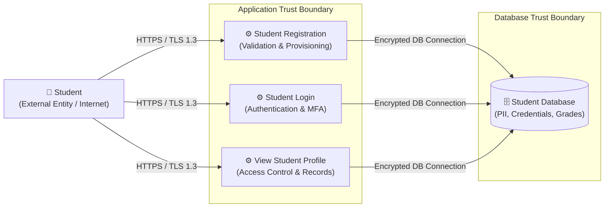

# 🛡️ Student Login Portal | Threat Modeling & Risk Assessment

### Halisans Technologies • Production Security Audit
**Lead Security Analyst:** Adekunle Olanrewaju | **Status:** Production Security Audit  
📍 Lagos, Nigeria · [LinkedIn](https://www.linkedin.com/in/adekunle-olanrewaju-20261844b) · [tayour.ola@gmail.com](mailto:tayour.ola@gmail.com) · [GitHub Profile](https://github.com/Adekunle-sec)

<p align="center">
  
</p>

<p align="center">
  <a href="https://github.com/Adekunle-sec"></a>
  <a href="https://github.com/Adekunle-sec/cybersecurity-portfolio"></a>
  <a href="https://www.linkedin.com/in/adekunle-olanrewaju-20261844b"></a>
  <a href="mailto:tayour.ola@gmail.com"></a>
</p>

---

## 📋 Executive Summary

This repository documents a formal production security assessment of a proposed cloud-hosted **Student Login Portal** for **Halisans Technologies**. The portal enables students to register, securely authenticate, and view their own personal academic profiles over public networks. 

The security assessment utilizes **OWASP Threat Dragon v2.6.2** to formulate an architectural Data Flow Diagram (DFD Level-1), systematically decompose attack surfaces using the **STRIDE** methodology, establish a quantitative risk register (CVSS 3.1 & 25-scale risk matrix), cross-map controls directly to **ISO/IEC 27001:2022 Annex A** and **NIST SP 800-53 Rev 5**, and deliver an actionable risk treatment plan.

---

## 🎯 Application Scope & Audit Boundaries

### In-Scope Architecture
- **External Entity:** Student accessing the portal via a modern web browser over untrusted public networks.
- **Three Core Application Processes:**
  1. `Student Registration`: Validates institutional eligibility, verifies student email, enforces password complexity, and provisions new accounts.
  2. `Student Login`: Authenticates returning students via credentials and Multi-Factor Authentication (MFA), enforces sliding-window rate limiting, and issues cryptographically signed session tokens.
  3. `View Student Profile`: Enforces strict session token binding and object-level authorization to allow students to retrieve and view their academic records.
- **Data Store:** `Student Database` storing student account credentials, salted password hashes (Argon2id), MFA secrets, Personally Identifiable Information (PII), and academic transcript records.
- **Known Communication Protocols:** Student Browser ↔ Application tier via encrypted **HTTPS / TLS 1.3** with HTTP Strict Transport Security (HSTS).

### Architecture Verification Points (Confirmed with Developers):
- **Backend-to-Database Protocol:** Mutually authenticated, encrypted database connection (TLS) over internal virtual network (VNet).
- **Database Hosting:** Managed PostgreSQL instance deployed within a private subnet behind network security groups (NSGs).
- **Session Mechanism:** Cryptographically signed, HTTP-only, SameSite Secure JWT session tokens with short expiration and refresh rotation.
- **Authorization Enforcement:** Server-side RBAC validation checking JWT claims on every profile request to prevent IDOR / BOLA vulnerabilities.

### Out of Scope:
- Administrator backend management functions (isolated to internal management subnet).
- Batch profile data import mechanisms.
- Live penetration testing and active exploitation against production systems.

---

## 🎯 Assessment Objectives

1. **DFD Modeling:** Translate the developer brief into a structured **Level-1 Data Flow Diagram (DFD)** featuring exactly the three core application processes.
2. **Protocol & Data Flow Labeling:** Explicitly label all data flows, network boundaries, and transport security controls.
3. **Trust Boundary Identification:** Define and justify institutional and operational trust perimeters separating the public internet, application compute tier, and database storage tier.
4. **STRIDE Threat Modeling:** Apply the STRIDE framework (Spoofing, Tampering, Repudiation, Information Disclosure, Denial of Service, Elevation of Privilege) across all elements.
5. **Quantitative Risk Scoring:** Score threat likelihood and impact on a 1–5 scale (derived from CVSS 3.1), document protective engineering controls, and establish a remediation roadmap with assigned asset owners.

---

## 🤝 Cross-Functional Architecture & Domain Ownership

In alignment with enterprise security operations at Halisans Technologies, this engagement coordinates across three primary defense pillars:

| Security Pillar | Domain Ownership & Core Contributions | Pillar Landing Page |
|:---|:---|:---:|
| **🔑 Identity & Access Management (IAM)** | **Anti-Spoofing & Authorization Defense:**<br>• Enforced MFA and Argon2id password hashing controls (`NST01`)<br>• Designed cryptographically validated JWT session claims preventing IDOR / BOLA<br>• Enforced server-side RBAC for student academic profile viewing (`NST38`) | [Explore IAM Pillar →](../../IAM/README.md) |
| **🛡️ Security Operations Center (SOC)** | **Architecture Modeling, Anti-Repudiation & Telemetry:**<br>• Translated developer brief into the Level-1 Data Flow Diagram (DFD)<br>• Structured immutable audit logging and SIEM ingestion to prevent activity denial (`NST29`)<br>• Configured WAF rate-limiting telemetry & SIEM threshold alert rules for login flooding (`NST17`) | [Explore SOC Pillar →](../README.md) |
| **📋 Governance, Risk & Compliance (GRC)** | **Risk Quantification, Regulatory Mapping & SLAs:**<br>• Converted CVSS 3.1 scores into a 5×5 / 25-scale Inherent Risk Matrix<br>• Mapped technical mitigations to **ISO/IEC 27001:2022 Annex A** & **NIST SP 800-53 Rev 5**<br>• Authored the Risk Treatment Plan with designated owners and remediation SLAs | [Explore GRC Pillar →](../../GRC/README.md) |

---

## 🏗️ System Architecture & Data Flow Diagram (DFD)

### 🖼️ Level-1 Data Flow Diagram (DFD)
<p align="center">
  
</p>

### 📐 Architectural Trust Boundaries & Elements



1. **External Entity (`Student`):** External users interacting from personal devices over public internet infrastructure outside corporate trust boundaries.
2. **Application Processing Tier (`Application Trust Boundary`):**
   - **Student Registration Process:** Validates input sanitization, enforces password complexity, and provisions student identities.
   - **Student Login Process:** Validates credentials, issues MFA challenges, throttles brute-force attempts, and mints secure session tokens.
   - **View Student Profile Process:** Enforces authorization checks ensuring students can only access their personal academic records.
3. **Data Persistence Tier (`Database Trust Boundary`):**
   - **Student Database:** Encrypted-at-rest database storing password hashes, profile details, and grade histories.
4. **Data Flows (`HTTPS / TLS 1.3`):** Secure encrypted transport channels enforcing strong cipher suites and HSTS.

---

## 🎯 STRIDE Threat Taxonomy & Attack Scenarios

The architecture was systematically evaluated against the **STRIDE** methodology:

| STRIDE Category | Risk ID | Threat Scenario | Primary Attack Vector | Inherent Severity |
|:---|:---|:---|:---|:---:|
| **Spoofing** | `NST01` | Student Account Takeover & Identity Impersonation | Automated credential stuffing, password spraying, or session token interception over untrusted networks. | **Critical** (14.04) |
| **Tampering** | `NST06` | Unauthorized Record Alteration & Parameter Tampering | HTTP request payload manipulation (mass assignment) or SQL injection crossing the database boundary to alter grades. | **Critical** (14.04) |
| **Repudiation** | `NST29` | Untraceable Authentication & Activity Denial | Users denying performed actions due to inadequate audit logging or disabled security event telemetry. | **Medium** (4.90) |
| **Information Disclosure** | `NST30` | Insecure Direct Object Reference (IDOR) & PII Exposure | Manipulating student profile IDs in HTTP requests to access unauthorized peer transcripts and personal contact data. | **High** (5.46) |
| **Denial of Service** | `NST17` | Authentication Endpoint Flooding & CPU Starvation | Volumetric HTTP floods targeting CPU-intensive password hashing functions (Argon2id/bcrypt) during peak registration windows. | **High** (5.04) |
| **Elevation of Privilege**| `NST38` | Horizontal & Vertical Privilege Escalation | Exploiting broken object-level authorization (BOLA) or role parameter tampering to gain elevated administrative rights. | **High** (9.36) |

---

## 📊 Quantitative Threat Risk Register Summary

From `Threat_Risk_Register.xlsx`, all identified risks were quantified using standard 5x5 Likelihood and Impact matrices and CVSS 3.1 scoring formulas:

```text
Inherent Risk Score = Likelihood (1–5) × Impact (1–5) [Converted from CVSS v3.1 10-scale by ÷ 2]
Target Residual Risk Score = Target Likelihood × Target Impact (Post-Mitigation)
```

### Risk Prioritization & Remediation SLAs (ISO 27001 Annex A8.8 Alignment):
- **25-Scale Matrix:** Critical (16–25) | High (11–15) | Medium (6–10) | Low (1–5)
- **Remediation SLA Targets:**
  - **Critical (CVSS 9.0–10.0):** Immediate containment and patch deployment (< 24–48 hours, e.g. RCE, Auth Bypass)
  - **High (CVSS 7.0–8.9):** Remediation required within 7 days
  - **Medium (CVSS 4.0–6.9):** Remediation required within 30 days (e.g. Stored/Reflected XSS)
  - **Low (CVSS < 4.0):** Remediation scheduled within 90 days (e.g. Minor Information Disclosure)
- **Four Core Risk Treatment Pathways:** Risk Mitigation, Risk Acceptance, Risk Transference, Risk Avoidance.

| Risk ID | Threat Classification | Inherent Likelihood | Inherent Impact | Inherent Score | Priority | Treatment Strategy | Target Residual Score |
|:---:|:---|:---:|:---:|:---:|:---:|:---:|:---:|
| **NST01** | Spoofing | 4 | 5 | **20 (High)** | P1 | Mitigate (MFA & Rate Limiting) | **4 (Low)** |
| **NST06** | Tampering | 3 | 5 | **15 (High)** | P1 | Mitigate (DTO Allow-list & ORM) | **3 (Low)** |
| **NST29** | Repudiation | 2 | 4 | **8 (Medium)**| P2 | Mitigate (Immutable Centralized SIEM) | **2 (Low)** |
| **NST30** | Information Disclosure | 3 | 4 | **12 (High)** | P2 | Mitigate (Session-Derived Token IDs) | **3 (Low)** |
| **NST17** | Denial of Service | 4 | 3 | **12 (High)** | P2 | Mitigate (Cloud WAF & Bounded Pools) | **3 (Low)** |
| **NST38** | Elevation of Privilege | 3 | 5 | **15 (High)** | P1 | Mitigate (Server-Side RBAC Enforcement) | **3 (Low)** |

---

## 🛡️ Risk Treatment Plan & Engineering Mitigations

From `Risk_Treatment_Plan.xlsx`, concrete defensive security engineering controls were formulated with assigned organizational owners:

### 1. Perimeter & Edge Defense (WAF & Rate Limiting)
- **Deployment:** Cloudflare / AWS WAF with Layer 7 DDoS mitigation and automated bot detection on `/login` and `/signup`.
- **Throttling:** Sliding-window rate limiting per IP and account (maximum 5 failed attempts per 10 minutes) with step-up challenges to prevent credential spraying.
- **Resource Protection:** Enforce maximum password input length validation (128 characters) before executing CPU-intensive Argon2id hashing algorithms.

### 2. Application & API Security (Anti-IDOR & Mass Assignment)
- **Anti-IDOR Architecture:** Eliminate user-supplied ID parameters in profile endpoints. The application strictly derives student identity from cryptographically validated, server-side JWT session claims.
- **Strict DTO Allow-Listing:** Implement JSON Schema validation rejecting unexpected fields (`role`, `is_admin`, `gpa`) to eliminate mass assignment vulnerabilities.
- **Frontend Hardening:** Enforce strict Content Security Policy (CSP) with nonces, `X-Content-Type-Options: nosniff`, and context-aware output encoding to block XSS.

### 3. Identity Governance & Session Hardening
- **Multi-Factor Authentication (MFA):** Enforce mandatory TOTP or FIDO2 WebAuthn authentication for returning student logins.
- **Session Protection:** Issue ephemeral, rotating access tokens stored strictly in `HttpOnly`, `Secure`, `SameSite=Strict` cookies to block token exfiltration via client-side scripts.
- **Credential Storage:** Hash all authentication passwords using **Argon2id** ($m=65536, t=3, p=4$) with per-user cryptographic salts.

### 4. Database & Persistence Layer Security
- **Data Protection:** Implement Transparent Data Encryption (TDE) for data-at-rest (AES-256) and TLS 1.3 for data-in-transit across the database subnet.
- **Zero Raw SQL Concatenation:** Mandate Object-Relational Mapping (ORM) parameterized queries across all database drivers to eliminate SQL injection.
- **Connection Isolation:** Connection pooling capped via PgBouncer with aggressive query timeouts to prevent connection pool starvation during volumetric attacks.

---

## 📜 Regulatory & Control Framework Mapping

From `Control_Mapping_Matrix.xlsx`, all engineered controls map directly to international compliance standards:

| Risk ID | Identified Threat | ISO/IEC 27001:2022 Annex A Mapping | NIST SP 800-53 Rev 5 Mapping |
|:---:|:---|:---|:---|
| **R-001 / NST01** | Spoofing | • **A.5.14** (Information transfer)<br>• **A.5.18** (Access rights)<br>• **A.8.5** (Secure authentication) | • **IA-2** (Identification and Authentication)<br>• **AC-2** (Account Management) |
| **R-004 / NST06** | Tampering | • **A.8.8** (Management of technical vulnerabilities)<br>• **A.8.26** (Application security requirements) | • **AC-4** (Information Flow Enforcement)<br>• **SI-10** (Information Input Validation) |
| **R-005 / NST29** | Repudiation | • **A.5.28** (Collection of evidence)<br>• **A.8.15** (Logging)<br>• **A.8.16** (Monitoring activities) | • **AU-2** (Event Logging)<br>• **AU-3** (Content of Audit Records)<br>• **AU-12** (Audit Record Generation) |
| **R-006 / NST30** | Information Disclosure | • **A.5.10** (Acceptable use of information)<br>• **A.8.12** (Data leakage prevention)<br>• **A.8.24** (Use of cryptography) | • **AC-3** (Access Enforcement)<br>• **SC-8** (Transmission Confidentiality)<br>• **SC-28** (Protection at Rest) |
| **R-007 / NST17** | Denial of Service | • **A.5.29** (Information security during disruption)<br>• **A.8.6** (Capacity management) | • **AC-7** (Unsuccessful Logon Attempts)<br>• **SC-5** (Denial of Service Protection) |
| **R-011 / NST38** | Elevation of Privilege | • **A.5.15** (Access control)<br>• **A.8.2** (Privileged access rights) | • **AC-6** (Least Privilege)<br>• **AC-3** (Access Enforcement) |

---

## 📁 Repository Deliverables & Artifact Manifest

| File | Type | Description |
|:---|:---:|:---|
| **[`DFD.png`](./DFD.png)** | Visual Artifact | High-resolution Level-1 Data Flow Diagram exported from OWASP Threat Dragon. |
| **[`Threat_Risk_Register.xlsx`](./Threat_Risk_Register.xlsx)** | Spreadsheet Model | Comprehensive STRIDE threat risk register with likelihood, impact, CVSS 3.1 scoring, and priority rankings. |
| **[`Risk_Treatment_Plan.xlsx`](./Risk_Treatment_Plan.xlsx)** | Governance Model | Detailed risk treatment register with assigned risk owners, implementation teams, and target residual scores. |
| **[`Control_Mapping_Matrix.xlsx`](./Control_Mapping_Matrix.xlsx)** | Compliance Matrix | Cross-reference matrix mapping each threat scenario to ISO/IEC 27001:2022 and NIST SP 800-53 Rev 5 controls. |
| **[`OWASP_Threat_Dragon_Report.pdf`](./OWASP_Threat_Dragon_Report.pdf)** | Formal Report | Complete 24-page native technical assessment report generated by OWASP Threat Dragon v2.6.2. |
| **[`Threat_Modelling_Model.json`](./Threat_Modelling_Model.json)** | Machine-Readable Model | The raw OWASP Threat Dragon model schema containing elements, boundaries, and threat definitions. |

---

## 🚀 How to Review & Replicate

1. **Inspect Data Flow Diagram:** Open [`DFD.png`](./DFD.png) in any image viewer.
2. **Review Spreadsheets:** Open [`Threat_Risk_Register.xlsx`](./Threat_Risk_Register.xlsx) and [`Risk_Treatment_Plan.xlsx`](./Risk_Treatment_Plan.xlsx) in any spreadsheet or tabular data viewer.
3. **Open the Model in OWASP Threat Dragon:**
   - Install or launch [OWASP Threat Dragon](https://owasp.org/www-project-threat-dragon/).
   - Click **Open an existing model**.
   - Select [`Threat_Modelling_Model.json`](./Threat_Modelling_Model.json) to visually explore diagram elements, trust boundaries, and threat cards.
4. **Read the Full Technical PDF:** Open [`OWASP_Threat_Dragon_Report.pdf`](./OWASP_Threat_Dragon_Report.pdf) for the comprehensive 24-page report.

---

## 🔒 Confidentiality & Standards Notice

> [!NOTE]  
> **Confidentiality:** No real credentials, tokens, internal IPs, customer data, sensitive alerts, personal identifiers, or unapproved screenshots are published. All operational telemetry uses synthetic or redacted evidence. Only materials approved for external sharing are published.

---

## 👨‍💻 Author & Contact

* **Lead Analyst**: Adekunle Olanrewaju
* **GitHub Profile**: [@Adekunle-sec](https://github.com/Adekunle-sec)
* **LinkedIn**: [adekunle-olanrewaju-20261844b](https://www.linkedin.com/in/adekunle-olanrewaju-20261844b)
* **Email**: [tayour.ola@gmail.com](mailto:tayour.ola@gmail.com)
* **Master Portfolio**: [Adekunle-sec / cybersecurity-portfolio](https://github.com/Adekunle-sec/cybersecurity-portfolio)
